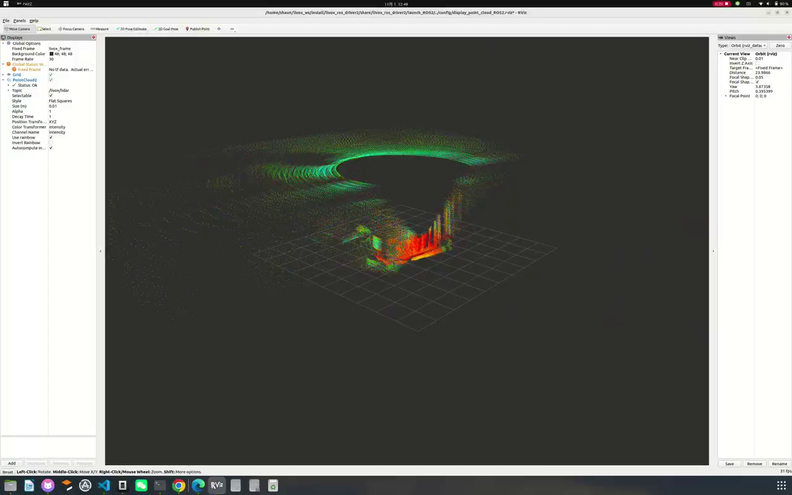
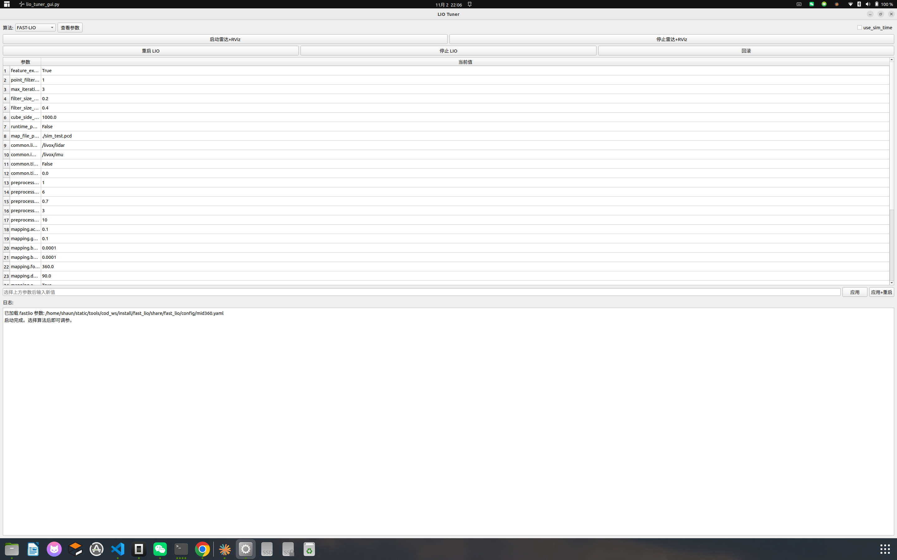
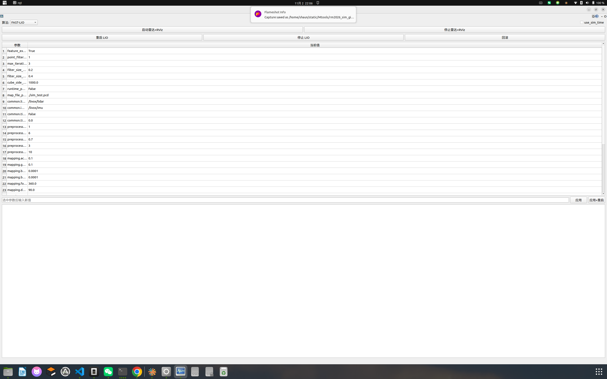
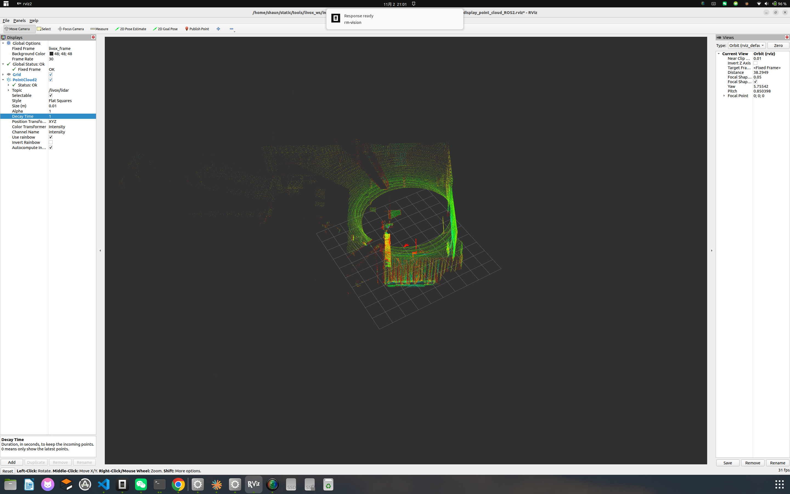
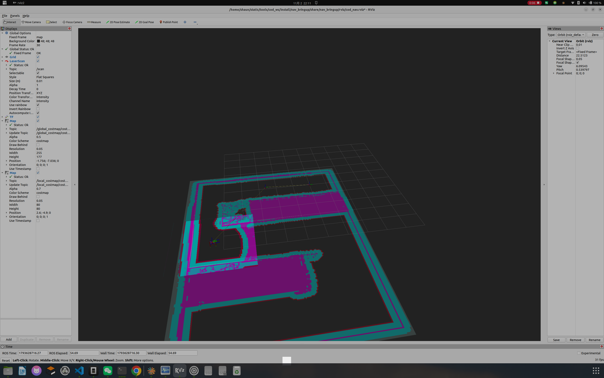

# RMUL 2026 3v3 Simulation + LIO Tuning Toolkit

整理自 RMUL 2026 3v3 导航仿真调试过程，包含：

- COD 2026 / Gazebo Classic 仿真入口
- FAST-LIO / Point-LIO 两套 LIO 启动方式
- MID-360S 真实雷达启动脚本（含 TF 和 PointCloud2 显示）
- LIO 参数调优 CLI、PyQt5 小窗口、rqt 插件
- 2026 地图、场地 STL、效果截图、压缩效果视频
- 2026 地图 PCD

> 本仓库是“仿真入口 + 工具 + 素材”的整理包，不包含 COD_NAV、COD_RM2026_Navigation、Livox SDK 源码。完整运行需要按下方说明准备上游依赖。

## 效果

| 真实雷达 RViz 点云 | LIO Tuner GUI |
| ------------ | ------------- |
|  |  |

| rqt 插件 | 真实雷达 + GUI 视角 |
| ------ | ------------- |
|  |  |

| 2026 仿真 RViz |
| ------------ |
|  |

效果视频：

- [真实雷达 RViz 点云](media/videos/lidar_pointcloud_rviz.mp4)
- [真实雷达 + GUI 点云](media/videos/lidar_pointcloud_gui.mp4)
- [2026 仿真 RViz 片段](media/videos/sim2026_navigation.mp4)

## 已验证结果

- 2026 地图 Nav2 目标 `(4.6, -5.5)` 返回 `SUCCEEDED`
- 真实 MID-360S `/livox/lidar` 约 `10 Hz`
- 推荐可跑通点位：左侧和底部走廊
  - `(0.0, -2.6)`
  - `(0.0, -5.5)`
  - `(4.6, -6.2)`
  - `(4.6, -5.5)`

## 目录结构

```text
.
├── envs/                        # meta workspace：本地 ROS 运行环境（git 忽略）
│   ├── livox_mid360s/           # 真实 MID-360S 驱动
│   ├── fastlio/                 # FAST-LIO 算法
│   ├── pointlio/                # Point-LIO 算法
│   ├── sim_tools/               # Gazebo / world / maps / 地图工具
│   ├── nav_2026/                # Nav2 launch / params / plugins
│   └── rqt_ui/                  # rqt 插件构建环境
├── third_party/                 # Livox-SDK2 / ros_deps（git 忽略）
├── scripts/                     # 统一入口
│   ├── menu.sh
│   ├── run_lidar.sh
│   ├── run_fastlio_2026.sh
│   ├── run_pointlio_2026.sh
│   ├── run_lio_tune.sh
│   ├── run_lio_tune_gui.sh
│   ├── go_fastlio_2026.sh
│   ├── go_pointlio_2026.sh
│   └── setup_split.sh
├── code/                        # GitHub 可见的入口/配置快照
│   ├── sim2026/
│   ├── cod26_sim/
│   └── livox_ws/
├── tools/lio_tune/              # 自研 LIO 调参工具
│   ├── lio_tune.py
│   ├── lio_tuner_gui.py
│   └── rqt_plugin/
├── assets/
│   ├── maps/
│   └── worlds/
├── media/
│   ├── images/
│   └── videos/
├── pcd/RM2026.pcd
└── docs/
    ├── CHANGES.md
    ├── CODE_GUIDE.md
    ├── WORKSPACES.md
    ├── TF_AND_RVIZ.md
    ├── SLAM_QA.md
    └── THIRD_PARTY.md
```

## Meta Workspace 统一入口

```bash
# 菜单
/home/shaun/static/Mtools/rm_sim/scripts/menu.sh

# 真实雷达 + RViz
/home/shaun/static/Mtools/rm_sim/scripts/run_lidar.sh

# FAST-LIO 2026 仿真
/home/shaun/static/Mtools/rm_sim/scripts/run_fastlio_2026.sh

# Point-LIO 2026 仿真
/home/shaun/static/Mtools/rm_sim/scripts/run_pointlio_2026.sh

# 调参
/home/shaun/static/Mtools/rm_sim/scripts/run_lio_tune.sh
/home/shaun/static/Mtools/rm_sim/scripts/run_lio_tune_gui.sh

# 发点
/home/shaun/static/Mtools/rm_sim/scripts/go_fastlio_2026.sh 4.6 -5.5 0
/home/shaun/static/Mtools/rm_sim/scripts/go_pointlio_2026.sh 4.6 -5.5 0

# 只加载所有 split 环境
source /home/shaun/static/Mtools/rm_sim/scripts/setup_split.sh
```

`envs/` 和 `third_party/` 已加入 `.gitignore`，不会上传到 GitHub；仓库只保留入口、配置、工具和素材。

## 依赖环境

实测版本：

```text
Ubuntu 22.04
ROS 2 Humble
Gazebo Classic 11.10.2
Nav2 Humble
Livox SDK2 1.5.2
livox_ros_driver2 1.2.8
Python 3.10
PyQt5
rqt
```

雷达：

```text
Livox MID-360S
主机: 192.168.1.50/24
雷达: 192.168.1.137
```

> MID-360S 不是 MID-360。必须使用 `MID360s_config.json` 和较新的 `livox_ros_driver2`。旧版 1.0.0 和 Livox Viewer 2.3.0 不支持。

上游仓库：

- [qza36/COD_NAV](https://github.com/qza36/COD_NAV)
- [codnavgation/cod\_-rm2026\_-navigation](https://gitee.com/codnavgation/cod_-rm2026_-navigation)
- [Livox-SDK/livox_ros_driver2](https://github.com/Livox-SDK/livox_ros_driver2)
- [Livox-SDK/Livox-SDK2](https://github.com/Livox-SDK/Livox-SDK2)

系统依赖（示例）：

```bash
sudo apt install \
  ros-humble-navigation2 ros-humble-nav2-bringup \
  ros-humble-slam-toolbox ros-humble-spatio-temporal-voxel-layer \
  ros-humble-topic-tools ros-humble-xacro ros-humble-joint-state-publisher \
  ros-humble-pcl-ros ros-humble-gazebo-ros-pkgs ros-humble-rviz2
```

## 编译顺序

```bash
source /opt/ros/humble/setup.bash

# 1. 雷达驱动 / 消息
cd envs/livox_mid360s && colcon build --symlink-install

# 2. LIO 算法
source envs/livox_mid360s/install/setup.bash
cd envs/fastlio && colcon build --symlink-install
cd ../pointlio && colcon build --symlink-install

# 3. 仿真/地图工具
cd ../sim_tools && colcon build --symlink-install

# 4. Nav2 配置和插件
cd ../nav_2026 && colcon build --symlink-install

# 5. rqt 插件
cd ../rqt_ui && colcon build --symlink-install
```

## TF 关系

真实雷达独立显示时，`livox_frame` 不是凭空存在的，必须把它挂到某个父坐标系上。教师建议“不上实车就写世界坐标系”，本仓库默认：

```text
world -> livox_frame
```

这是单位变换，`x=y=z=0`、`rpy=0`。RViz 的 Fixed Frame 使用 `world`。

仿真和实车建议的完整 TF 链：

```text
# 2026 COD_NAV + FAST-LIO 仿真
map -> odom -> chassis -> chassis_fake
chassis -> livox_frame

# 2026 COD_RM2026 + Point-LIO 仿真
map -> odom -> base_link -> base_link_fake
base_link -> livox_frame

# 实车
map -> odom -> base_link
base_link -> livox_frame   # 使用实际安装外参
```

查看 TF 树：

```bash
ros2 run rqt_tf_tree rqt_tf_tree
# 或
ros2 run tf2_tools view_frames
```

检查 `world -> livox_frame`：

```bash
ros2 run tf2_ros tf2_echo world livox_frame
```

## RViz 中显示 PointCloud2

`code/livox_ws/livox_pointcloud.rviz` 已配置好：

```text
Fixed Frame: world
Topic:       /livox/lidar
Type:        sensor_msgs/msg/PointCloud2
Style:       Flat Squares
Size (m):    0.02
Decay Time:  0.5
Alpha:       1
Color:       Intensity
```

说明：

- `Decay Time = 0`：只显示当前帧，通常看起来最稀
- `Decay Time = 0.5`：保留 0.5 秒点云，视觉效果更连续
- `Decay Time = 1~2`：更密，但太大会拖影
- `Size (m)`：点的显示大小，不是实际点数量
- 真正降采样：FAST-LIO 用 `point_filter_num` / `filter_size_map`；Point-LIO 用 `space_downsample_leaf_size`

独立启动雷达：

```bash
/home/shaun/static/Mtools/rm_sim/scripts/run_lidar.sh
```

这个脚本现在会自动启动：

```text
world -> livox_frame 静态 TF
livox_ros_driver2（PointCloud2 模式）
rviz2（livox_pointcloud.rviz）
```

## 仿真运行

### 2026 COD_NAV + FAST-LIO

```bash
/home/shaun/static/Mtools/rm_sim/scripts/run_fastlio_2026.sh
```

发点：

```bash
/home/shaun/static/Mtools/rm_sim/scripts/go_fastlio_2026.sh 4.6 -5.5 0
```

### 2026 COD_RM2026 + Point-LIO

```bash
/home/shaun/static/Mtools/rm_sim/scripts/run_pointlio_2026.sh
```

发点：

```bash
/home/shaun/static/Mtools/rm_sim/scripts/go_pointlio_2026.sh 4.6 -5.5 0
```

## LIO 调参工具

CLI：

```bash
python3 /home/shaun/static/Mtools/lio_tune/lio_tune.py
```

常用：

```bash
python3 /home/shaun/static/Mtools/lio_tune/lio_tune.py list
python3 /home/shaun/static/Mtools/lio_tune/lio_tune.py show fastlio
python3 /home/shaun/static/Mtools/lio_tune/lio_tune.py set fastlio point_filter_num 2 --restart
python3 /home/shaun/static/Mtools/lio_tune/lio_tune.py restart pointlio
python3 /home/shaun/static/Mtools/lio_tune/lio_tune.py rollback
```

PyQt5 小窗口：

```bash
python3 /home/shaun/static/Mtools/lio_tune/lio_tuner_gui.py
```

rqt 插件：

```bash
unset AMENT_CURRENT_PREFIX
unset COLCON_CURRENT_PREFIX

source /opt/ros/humble/setup.zsh
source /home/shaun/static/Mtools/rm_sim/envs/rqt_ui/install/setup.zsh

rqt --force-discover -s rqt_lio_tune.plugin.LioTunerPlugin
```

### 调参可改参数

FAST-LIO：

```yaml
point_filter_num: 1
filter_size_surf: 0.2
filter_size_map: 0.4
```

Point-LIO：

```yaml
point_filter_num: 1
space_downsample: true
space_downsample_leaf_size: 0.5
```

工具会自动备份配置，重启对应 LIO 节点；不会重启雷达驱动、Gazebo 或 Nav2。

## 迁移到自己的目录

本包中的脚本来自本机整理路径。复制到自己的 workspace 后，建议先搜索：

```bash
grep -R "/home/shaun/static" .
```

然后把脚本里的绝对路径改成自己的路径，或使用环境变量。

## 已知问题

1. **Gazebo GUI 崩溃**
   - 本机 Gazebo Classic `gzclient` 有 Ogre 断言崩溃。
   - 仿真入口使用 `gzserver` 无界面 + RViz 显示。
2. **2026 地图和社区场地 STL 存在局部偏差**
   - 左侧和底部走廊点位已跑通。
   - 右侧/中央部分点位可能卡住，需要重新对齐地图和世界模型。
3. **真实雷达网络地址**
   - USB 网卡必须是 `192.168.1.50/24`。
   - 曾经出现过被 NetworkManager 配成 `196.168.1.50` 的情况，会导致驱动 `bind failed`。

## 关于 PCD

`pcd/RM2026.pcd` 是 2026 地图点云参考文件，来源说明见 [pcd/README.md](pcd/README.md)。  
本仓库未提供完整建图过程产生的新 PCD；如需保存自己的 PCD，请参考文档中的建图命令或替换该文件。

- [工作区分层说明](docs/WORKSPACES.md)
- [代码阅读指南](docs/CODE_GUIDE.md)
- [TF 与 RViz 说明](docs/TF_AND_RVIZ.md)
- [SLAM / 论文 / 代码理解问答](docs/SLAM_QA.md)
- [修改记录](docs/CHANGES.md)
- [第三方来源](docs/THIRD_PARTY.md)

## 说明

- 本仓库整理的是仿真入口、配置、自研工具和效果素材。
- 完整运行仍需要上游 COD_NAV / COD_RM2026_Navigation / Livox 驱动。
- 第三方代码、地图和场地模型版权归各自作者所有。
