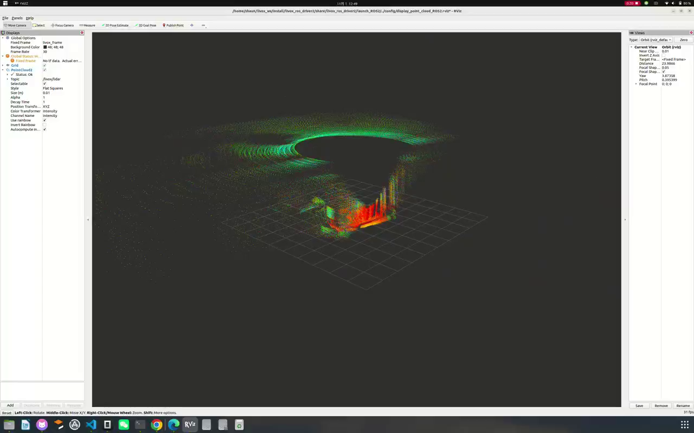
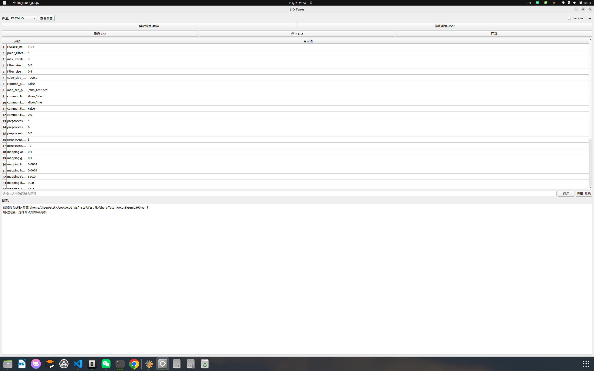
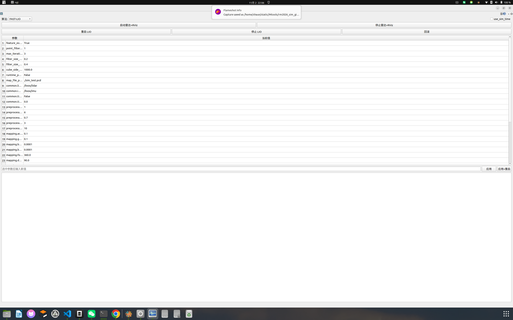
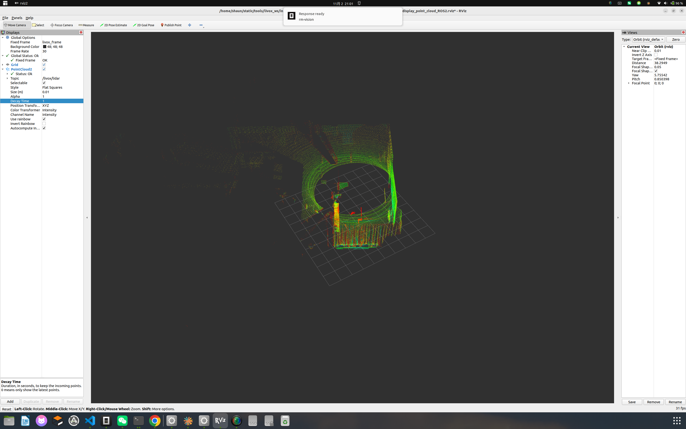
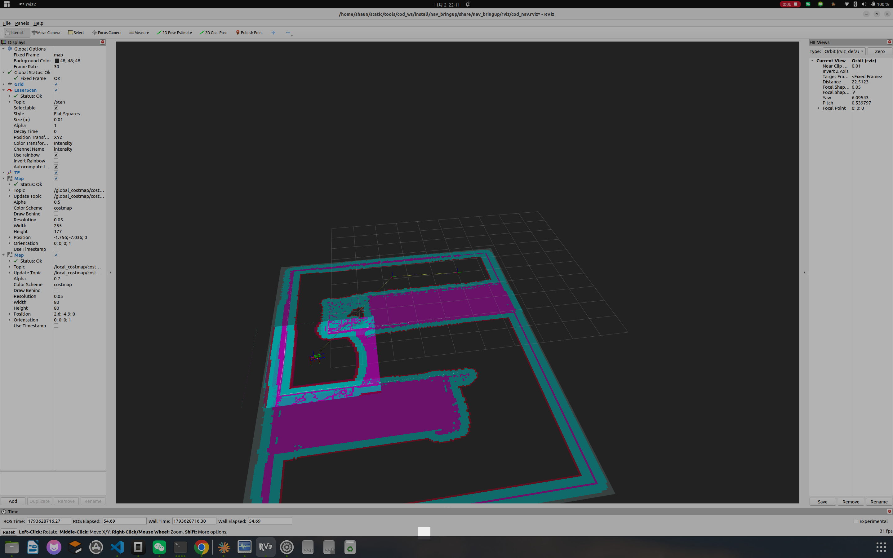

# RMUL 2026 3v3 Simulation + LIO Toolkit

RMUL 2026 3v3 导航仿真、真实 MID-360S 雷达、FAST-LIO / Point-LIO 和调参工具的 meta workspace。

> 本仓库只保留入口、配置、工具和素材。
>
> `envs/`、`third_party/` 是本地运行环境，已加入 `.gitignore`，不会上传 GitHub。
>
> 本地完整环境已经整理好，日常运行按 README 的入口表操作，不需要再搜索路径。

## 效果

| 真实雷达 RViz 点云 | LIO Tuner GUI |
|---|---|
|  |  |

| rqt 插件 | 真实雷达 + GUI 视角 |
|---|---|
|  |  |

| 2026 仿真 RViz |
|---|
|  |

效果视频：

- [真实雷达 RViz 点云](media/videos/lidar_pointcloud_rviz.mp4)
- [真实雷达 + GUI 点云](media/videos/lidar_pointcloud_gui.mp4)
- [2026 仿真 RViz 片段](media/videos/sim2026_navigation.mp4)

## 教学文档

从 [教学文档总目录](docs/TUTORIAL_INDEX.md) 开始。

- [虚拟仿真：FAST-LIO](docs/TUTORIAL_SIM_FASTLIO.md)
- [虚拟仿真：Point-LIO](docs/TUTORIAL_SIM_POINTLIO.md)
- [真实 MID-360S 雷达](docs/TUTORIAL_LIDAR.md)
- [真实雷达建图](docs/TUTORIAL_MAPPING.md)
- [LIO 调参](docs/TUTORIAL_LIO_TUNE.md)
- [串口协议与 COD 代码](docs/TUTORIAL_SERIAL.md)
- [迁移到另一台机器](docs/TUTORIAL_MIGRATION.md)
- [常见问题](docs/TROUBLESHOOTING.md)

已验证：

```text
FAST-LIO 2026 仿真：Nav2 active，目标点 (4.6, -5.5) SUCCEEDED
Point-LIO 2026 仿真：Nav2 active，目标点 (4.6, -5.5) SUCCEEDED
真实 MID-360S：/livox/lidar 约 10 Hz
```

---

## 1. Meta Workspace 结构

```text
rm_sim/
├── LIO-Tuner.desktop            # 双击启动 LIO Tuner
├── envs/                        # 本地 ROS 运行环境，git 忽略
│   ├── livox_mid360s/           # 真实 MID-360S 驱动 + Livox 消息
│   ├── fastlio/                 # FAST-LIO 算法
│   ├── pointlio/                # Point-LIO 算法
│   ├── sim_tools/               # Gazebo、worlds、maps、pcd2pgm、定位、sim 编排
│   ├── nav_2026/                # Nav2 launch/params/plugins
│   └── rqt_ui/                  # rqt_lio_tune 构建环境
├── third_party/                 # Livox-SDK2 / ros_deps，git 忽略
├── scripts/                     # 统一入口
│   ├── menu.sh
│   ├── setup_split.sh
│   ├── run_lidar.sh
│   ├── run_fastlio_2026.sh
│   ├── run_pointlio_2026.sh
│   ├── go_fastlio_2026.sh
│   ├── go_pointlio_2026.sh
│   ├── run_lio_tune.sh
│   ├── run_lio_tune_gui.sh
│   ├── build_all.sh
│   ├── check_env.sh
│   ├── install_deps.sh
│   ├── install_desktop.sh
│   ├── make_migration_bundle.sh
│   └── rewrite_paths.sh
├── code/                        # GitHub 可见的入口/配置快照
├── tools/lio_tune/              # 自研 LIO 调参工具源码
├── assets/                      # 地图 / 场地 STL
├── media/                       # 截图 / 压缩视频
├── pcd/RM2026.pcd               # 2026 地图点云参考文件
└── docs/                        # 架构、TF、SLAM、来源说明
```

### 各环境职责

| 环境 | 主要包 | 作用 |
|---|---|---|
| `envs/livox_mid360s` | `livox_ros_driver2` | 连接真实 MID-360S，发布 PointCloud2/IMU |
| `envs/fastlio` | `fast_lio` | FAST-LIO 里程计 |
| `envs/pointlio` | `small_point_lio` | Point-LIO 里程计 |
| `envs/sim_tools` | `pb_rm_simulation`、`ros2_livox_simulation`、`pcd2pgm`、`ndt_omp_ros2`、`small_gicp_relocalization`、`lidar_localization_ros2`、`patchworkpp`、`sim2026`、`pointlio_sim` | Gazebo 仿真和地图工具 |
| `envs/nav_2026` | `nav_bringup`、`cod_bringup`、Nav2 插件、`pointcloud_to_laserscan`、`fake_vel_transform`、`cpp_lidar_filter` | Nav2 导航 |
| `envs/rqt_ui` | `rqt_lio_tune` | rqt 调参插件 |

### 依赖关系

```text
livox_mid360s
  ├── fastlio
  ├── pointlio
  └── sim_tools

sim_tools
  └── nav_2026

rqt_ui 独立
```

---

## 2. 版本与依赖

实测环境：

```text
Ubuntu 22.04
ROS 2 Humble
Gazebo Classic 11.10.2
Nav2 Humble
Livox SDK2 1.5.2
livox_ros_driver2 1.2.8
Python 3.10
PyQt5
rqt
```

真实雷达：

```text
Livox MID-360S
主机 IP: 192.168.1.50/24
雷达 IP: 192.168.1.137
```

系统依赖示例：

```bash
sudo apt install \
  ros-humble-navigation2 ros-humble-nav2-bringup \
  ros-humble-slam-toolbox ros-humble-spatio-temporal-voxel-layer \
  ros-humble-topic-tools ros-humble-xacro ros-humble-joint-state-publisher \
  ros-humble-pcl-ros ros-humble-gazebo-ros-pkgs ros-humble-rviz2
```

> MID-360S 不是 MID-360。  
> 必须使用 `MID360s_config.json` 和较新的 `livox_ros_driver2`。  
> 旧版 1.0.0 和 Livox Viewer 2.3.0 不支持 MID-360S。

---

## 3. 第一次编译

按依赖顺序编译：

```bash
source /opt/ros/humble/setup.bash

# 1. 雷达驱动 / 消息
cd envs/livox_mid360s
colcon build --symlink-install

# 2. LIO 算法
source install/setup.bash
cd ../fastlio
colcon build --symlink-install
cd ../pointlio
colcon build --symlink-install

# 3. 仿真和地图工具
cd ../sim_tools
colcon build --symlink-install

# 4. Nav2
cd ../nav_2026
colcon build --symlink-install

# 5. rqt 插件
cd ../rqt_ui
colcon build --symlink-install
```

加载所有环境：

```bash
source /home/shaun/static/Mtools/rm_sim/scripts/setup_split.sh
```

---

## 4. 日常运行入口

### 菜单

```bash
/home/shaun/static/Mtools/rm_sim/scripts/menu.sh
```

### 真实雷达 + RViz

```bash
/home/shaun/static/Mtools/rm_sim/scripts/run_lidar.sh
```

检查：

```bash
ip -br addr
# 必须看到 192.168.1.50/24
ping -c 3 192.168.1.137
```

### FAST-LIO 2026 仿真

```bash
/home/shaun/static/Mtools/rm_sim/scripts/run_fastlio_2026.sh
```

发点：

```bash
/home/shaun/static/Mtools/rm_sim/scripts/go_fastlio_2026.sh 4.6 -5.5 0
```

### Point-LIO 2026 仿真

```bash
/home/shaun/static/Mtools/rm_sim/scripts/run_pointlio_2026.sh
```

发点：

```bash
/home/shaun/static/Mtools/rm_sim/scripts/go_pointlio_2026.sh 4.6 -5.5 0
```

### LIO 调参

```bash
/home/shaun/static/Mtools/rm_sim/scripts/run_lio_tune.sh
/home/shaun/static/Mtools/rm_sim/scripts/run_lio_tune_gui.sh
```

常用：

```bash
python3 tools/lio_tune/lio_tune.py list
python3 tools/lio_tune/lio_tune.py show fastlio
python3 tools/lio_tune/lio_tune.py set fastlio point_filter_num 2 --restart
python3 tools/lio_tune/lio_tune.py restart pointlio
python3 tools/lio_tune/lio_tune.py rollback
```

### rqt 插件

```bash
unset AMENT_CURRENT_PREFIX
unset COLCON_CURRENT_PREFIX

source /opt/ros/humble/setup.zsh
source envs/rqt_ui/install/setup.zsh

rqt --force-discover -s rqt_lio_tune.plugin.LioTunerPlugin
```

---

## 5. 配置文件位置

### FAST-LIO

源码：

```text
envs/fastlio/src/fast_lio/config/mid360.yaml
```

实际安装：

```text
envs/fastlio/install/fast_lio/share/fast_lio/config/mid360.yaml
```

参数：

```yaml
point_filter_num: 1
filter_size_surf: 0.2
filter_size_map: 0.4
```

### Point-LIO

源码：

```text
envs/pointlio/src/small_point_lio/config/mid360.yaml
```

实际安装：

```text
envs/pointlio/install/small_point_lio/share/small_point_lio/config/mid360.yaml
```

参数：

```yaml
point_filter_num: 1
space_downsample: true
space_downsample_leaf_size: 0.5
```

### 仿真配置

```text
envs/sim_tools/sim2026/          # FAST-LIO 2026 仿真
envs/sim_tools/pointlio_sim/     # Point-LIO 2026 仿真
```

### Nav2 配置

```text
envs/nav_2026/src/nav_bringup/params/
envs/nav_2026/src/cod_bringup/params/
```

---

## 6. TF 关系

真实雷达独立显示：

```text
world -> livox_frame
```

FAST-LIO 仿真：

```text
map -> odom -> chassis -> chassis_fake
chassis -> livox_frame
```

Point-LIO 仿真：

```text
map -> odom -> base_link -> base_link_fake
base_link -> livox_frame
```

实车：

```text
map -> odom -> base_link
base_link -> livox_frame   # 使用实际安装外参
```

检查：

```bash
ros2 run rqt_tf_tree rqt_tf_tree
ros2 run tf2_ros tf2_echo world livox_frame
```

---

## 7. RViz 显示 PointCloud2

配置文件：

```text
code/livox_ws/livox_pointcloud.rviz
```

关键设置：

```text
Fixed Frame: world
Topic:       /livox/lidar
Type:        sensor_msgs/msg/PointCloud2
Style:       Flat Squares
Size (m):    0.02
Decay Time:  0.5
Alpha:       1
Color:       Intensity
```

说明：

```text
Decay Time = 0      只显示当前帧，看起来最稀
Decay Time = 0.5    推荐
Decay Time = 1~2    更密，但可能拖影

Size = 0.01         细
Size = 0.02         推荐
Size = 0.05         更明显
```

注意：

```text
Decay Time 是显示累积，不是传感器真实密度
Size 是点的显示大小，不是降采样
```

---

## 8. PCD

当前仓库包含：

```text
pcd/RM2026.pcd
```

它是 2026 地图点云参考文件，来源见 `pcd/README.md`，不是本次仿真新建的 PCD。

FAST-LIO 保存：

```yaml
pcd_save:
  pcd_save_en: true
  interval: -1
map_file_path: "/home/shaun/static/Mtools/rm_sim/pcd/sim_test.pcd"
```

Point-LIO 保存：

```yaml
save_pcd: true
```

运行后调用：

```bash
ros2 service call /map_save std_srvs/srv/Trigger
```

---

## 9. 已知问题

1. **Gazebo GUI 崩溃**
   - 本机 Gazebo Classic `gzclient` 有 Ogre 断言崩溃。
   - 仿真入口使用 `gzserver` 无界面 + RViz。

2. **2026 地图和社区场地 STL 存在局部偏差**
   - 左侧和底部走廊点位已跑通。
   - 右侧/中央部分点位可能卡住，需要继续对齐 world 和 map。

3. **真实雷达网络**
   - USB 网卡必须是 `192.168.1.50/24`。
   - 曾出现被 NetworkManager 配成 `196.168.1.50`，会导致驱动 `bind failed`。

4. **PointCloud2 太稀/太密**
   - RViz 调 `Decay Time` 和 `Size`。
   - 真正降采样看 LIO 的 `point_filter_num` / `leaf_size`。

---

## 10. 文档

```text
docs/WORKSPACES.md    # meta workspace 分层
docs/CODE_GUIDE.md    # 代码阅读路线
docs/TF_AND_RVIZ.md   # TF 和 PointCloud2
docs/TUTORIAL_SERIAL.md # 串口协议与 COD 代码
docs/TUTORIAL_MIGRATION.md # 迁移到另一台机器
docs/SLAM_QA.md       # 老师问题准备
docs/CHANGES.md       # 修改记录
docs/THIRD_PARTY.md   # 第三方来源
```

---

## 11. 上游和来源

- [qza36/COD_NAV](https://github.com/qza36/COD_NAV)
- [codnavgation/cod_-rm2026_-navigation](https://gitee.com/codnavgation/cod_-rm2026_-navigation)
- [Livox-SDK/livox_ros_driver2](https://github.com/Livox-SDK/livox_ros_driver2)
- [Livox-SDK/Livox-SDK2](https://github.com/Livox-SDK/Livox-SDK2)

第三方代码、地图和场地模型版权归各自作者所有。
